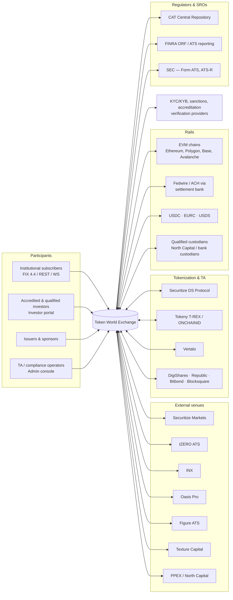
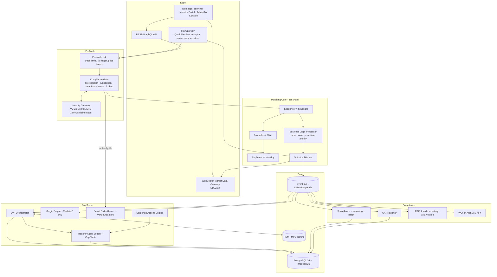
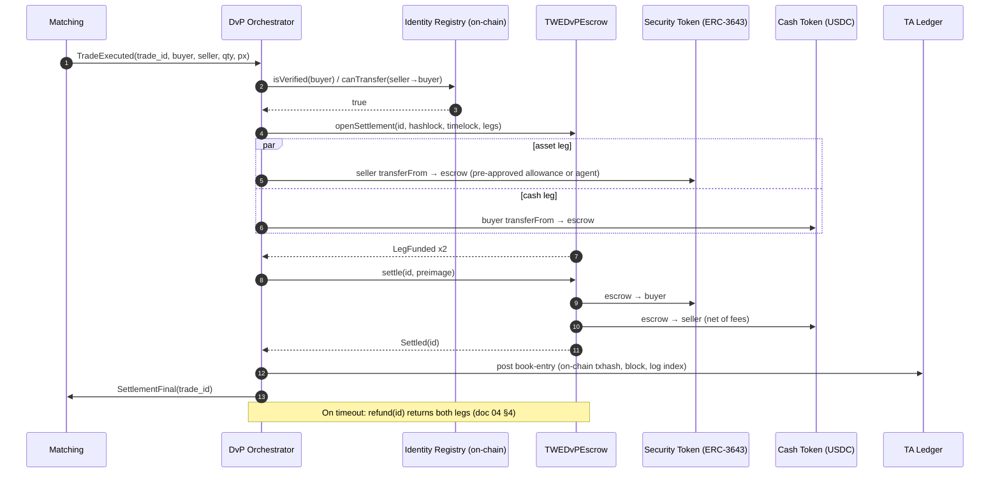

# 01 — System Architecture

Status: Draft v1.0 · Owner: Architecture · Applies to: Modules A–D

## 1. Goals and non-goals

**Goals**

1. Deterministic, replayable matching: the same ordered input journal MUST produce a bit-identical output stream (fills, book state, sequence numbers).
2. Compliance runs *before* the sequencer. No order reaches the book without a recorded pre-trade compliance decision (accreditation, jurisdiction, sanctions, freeze, lockup/holding period, offering-exemption transfer restrictions).
3. Settlement is decoupled from matching. A match creates a settlement obligation; it does not move assets. The DvP orchestrator (doc 04) owns asset movement.
4. Every state transition is journaled in an append-only, hash-chained WAL that serves as books-and-records source for Rule 17a-3/17a-4 and Reg ATS Rule 302/303.
5. Strict entity segregation: Module A/B (securities, BD) and Module C (crypto, non-security) run in separate trust domains with separate ledgers, separate keys, and separate regulatory reporting, sharing only code and infrastructure patterns.

**Non-goals (v1)**: retail margin lending on securities; NMS stock trading (would trigger Form ATS-N and Reg SCI analysis); cross-entity netting between Modules A and C.

## 2. System context



## 3. Container view



### 3.1 Service responsibilities

| Container | Language (prod) | State | Notes |
|---|---|---|---|
| FIX Gateway | Rust or Java (QuickFIX/J) | Session seq numbers, resend store | One process per session group; stateless w.r.t. orders |
| Compliance Gate | Rust | Read-through cache of investor eligibility, refreshed by events | Decision record (`compliance_decisions`) written synchronously before sequencing |
| Sequencer + BLP | Rust (single-threaded per shard) | In-memory books, snapshot every N events | Shard = set of instruments; each instrument belongs to exactly one shard |
| Journaler | Rust | WAL segments on NVMe, fsync'd before ACK | Hash-chained (SHA-256 of prev record) |
| DvP Orchestrator | TypeScript/Go | Saga state in Postgres | Idempotent steps, outbox pattern |
| SOR | Rust/TypeScript | Venue quote cache | Routing decisions journaled for 5310 review |
| Surveillance | Python/Flink | Feature windows | Alerts to case management |
| CAT Reporter | Go | Submission batches, feedback | Nightly file by 8:00 a.m. ET T+1 deadline |

## 4. Order lifecycle (Module A, on-venue match with on-chain DvP)

```mermaid
sequenceDiagram
  autonumber
  participant C as Subscriber (FIX)
  participant G as FIX Gateway
  participant R as Pre-trade Risk
  participant K as Compliance Gate
  participant S as Sequencer/Journal
  participant M as Matching BLP
  participant P as Publishers
  participant D as DvP Orchestrator
  participant A as CAT Reporter

  C->>G: 35=D NewOrderSingle (5001 RegExemption, 5002 InvestorClaimHash)
  G->>G: Validate session, seq, BodyLength, CheckSum, schema
  G->>R: OrderIntent
  R->>R: Credit limit, price band (±X% of ref), max notional
  R->>K: OrderIntent + risk OK
  K->>K: accreditation, jurisdiction, OFAC/sanctions, wallet freeze, lockup / Rule 144 holding period, offering caps
  alt rejected
    K-->>G: Reject(reason code)
    G-->>C: 35=8 150=8 39=8 5012=reason
    K->>K: Persist rejected intent as books-and-records item (not an ATS order; see doc 05 §4.3)
  else accepted
    K->>S: Sequenced command (compliance_decision_id)
    S->>S: Assign global seq, journal + fsync, replicate
    S->>M: Apply
    M->>P: OrderAccepted, [Trade...], BookDelta
    P-->>G: 35=8 150=0 (New)
    G-->>C: ExecutionReport New
    P->>A: MEOA (order accepted by ATS)
    opt crossed
      P-->>G: 35=8 150=F 39=1/2
      P->>D: SettlementObligation(trade_id)
      P->>A: MEOT
    end
  end
  D->>D: Lock seller tokens + buyer cash in escrow (doc 04)
  D-->>P: SettlementStatus events
  P-->>G: (optional) 35=8 with 5011 DvPState updates
```

Note on the reject branch: an order rejected by the gate before acceptance never becomes an ATS order. The rejecting record is retained as a books-and-records item; CAT reportability of the *subscriber's* order belongs to the subscriber's own CAT obligations. See doc 05.

## 5. Settlement sequence (atomic on-chain DvP)



## 6. Matching core — LMAX/Disruptor design

The production core follows the LMAX architecture: a single-threaded Business Logic Processor (BLP) fed by a lock-free ring buffer, with journaling and replication performed by parallel consumers that gate the BLP.

```
                         ┌──────────────────────────── INPUT RING (2^20 slots, pre-allocated) ─────────────────────────────┐
  FIX/REST/Compliance    │  slot: { seq:u64, recv_ns:i64, kind:u8, instrument:u32, payload:[u8;256], decision_id:u128 }   │
  ───────────────────►   │                                                                                                  │
   [Receiver/Unmarshal]  │   ▲ claim(seq)            ▲ journaler cursor     ▲ replicator cursor      ▲ BLP cursor         │
         │ publish(seq)  └───┼──────────────────────┼──────────────────────┼─────────────────────────┼────────────────────┘
         └───────────────────┘                      │                      │                         │
                                     ┌──────────────┴─────┐   ┌────────────┴─────────┐   ┌───────────┴────────────────┐
                                     │ JOURNALER          │   │ REPLICATOR           │   │ BUSINESS LOGIC PROCESSOR    │
                                     │ append to WAL seg  │   │ stream slots to      │   │ single thread, no locks,    │
                                     │ SHA-256 chain      │   │ standby over         │   │ no I/O, no clock reads      │
                                     │ fsync (group commit│   │ RDMA/TCP; await ack  │   │ (time = slot.recv_ns)       │
                                     │ ≤ 50 µs window)    │   │ (sync mode)          │   │ order books: price levels → │
                                     └────────────────────┘   └──────────────────────┘   │ intrusive FIFO lists        │
                                              BLP waits on: min(journal_cursor, repl_cursor) │ emits events into OUT RING  │
                                                                                           └───────────┬────────────────┘
                         ┌──────────────────────────── OUTPUT RING ───────────────────────────────────┼────────────────┐
                         │  events: OrderAccepted | Trade | Cancelled | BookDelta | Rejected(engine)  ▼                │
                         └───────┬──────────────────┬───────────────────┬────────────────────┬─────────────────────────┘
                                 ▼                  ▼                   ▼                    ▼
                         [FIX ExecRpt pub]   [MD publisher L1/L2/L3] [Kafka bridge: DvP,   [Snapshotter: every 1M
                                                                      CAT, Surveillance]    events → object store]
```

### 6.1 Rules for the BLP

* **No wall-clock reads.** Time is the sequencer-stamped `recv_ns` of the slot. Time-based events (GTD expiry, auction uncross, session close) enter as explicit `TimerTick` commands from a dedicated timer producer, so they are journaled and replayable.
* **No randomness, no hash-map iteration order dependence.** Use ordered structures (B-tree of price levels, intrusive linked lists per level) and deterministic IDs (`order_id = shard_id << 48 | seq`).
* **Fixed-point only.** `price_ticks: i64`, `qty_lots: i64`; notional uses `i128`.
* **Price-time priority.** Best price first; within a level, earliest `seq` first. Amend that increases quantity or changes price loses priority; quantity decrease keeps priority.
* **Self-trade prevention (STP)** keyed by beneficial-owner group ID: modes `CANCEL_NEWEST` (default), `CANCEL_OLDEST`, `CANCEL_BOTH`, `DECREMENT`. STP events are journaled and feed wash-trade surveillance.
* **Engine-level rejects** (e.g., post-only would cross) are emitted as events; they do not mutate the book.

### 6.2 Determinism and replay

```
state_N = fold(apply, snapshot_k, WAL[k+1 .. N])
digest_N = SHA-256(digest_{N-1} || canonical(output_events_N))
```

* Every 10,000 sequences the BLP emits a `StateDigest{seq, book_hash, output_hash}`. Primary and standby compare digests; divergence triggers an immediate halt of the standby and a P1 incident.
* **Replay tool** (`twe-replay`): given snapshot + WAL range, rebuilds books and re-emits outputs; CI runs a golden-journal replay on every core commit and asserts identical digests.
* **Regulatory reconstruction**: replaying to any seq reproduces the order book as it stood at that moment (supports surveillance investigations, Rule 17a-4 inquiries and CAT error correction).

### 6.3 WAL record format (core)

| Field | Type | Notes |
|---|---|---|
| `seq` | u64 | Gapless, global per shard |
| `prev_hash` | [u8;32] | SHA-256 of previous record |
| `recv_ns` | i64 | Sequencer timestamp (PTP-disciplined clock) |
| `kind` | u8 | NEW, CANCEL, REPLACE, TIMER, HALT, RESUME, ADMIN_* |
| `decision_id` | u128 | FK to compliance decision; zero only for TIMER/ADMIN |
| `payload` | bytes | Canonical binary (SBE) encoding |
| `crc32c` | u32 | Torn-write detection |

The Postgres `wal_events` table (doc 06) mirrors this for the sandbox prototype and for downstream audit; a trigger forbids UPDATE/DELETE.

## 7. Latency budgets (production target, p99, colocated FIX client)

| Hop | Budget | Notes |
|---|---|---|
| NIC → FIX gateway parse + session validation | 15 µs | Kernel-bypass optional (v2) |
| Pre-trade risk | 5 µs | In-memory limits |
| Compliance gate (cache hit) | 20 µs | Cache miss → synchronous lookup ≤ 2 ms, order held, not rejected |
| Ring publish → journal fsync (group commit) | 60 µs | NVMe, 50 µs commit window |
| Sync replication ack | 80 µs | Same metro, dedicated link; parallel with fsync |
| BLP match | 5 µs | Single order, ≤ 10 fills |
| Output → ExecutionReport on wire | 20 µs | |
| **Order-to-ack total** | **≤ 200 µs p99, ≤ 1 ms p99.99** | |
| Market data L2 delta fan-out | ≤ 250 µs from match | WS gateway adds client-dependent jitter |
| Trade → DvP escrow open (on-chain) | ≤ 2 s submit; finality chain-dependent | |
| Trade → CAT record staged | ≤ 5 s | Submission is batch (T+1 08:00 ET) |

Tokenized private securities trade far less frequently than equities; these budgets exist to bound tail latency and fairness rather than to compete on HFT speed. Module C (crypto) has the tightest real-world requirement.

## 8. High availability

* **Active/passive per shard** with synchronous WAL replication. The standby consumes the replicated input stream and runs its own BLP in lockstep (hot standby), so failover requires no replay beyond the in-flight window.
* **Failover protocol**: (1) primary lease in etcd (TTL 2 s); (2) on lease loss, standby verifies last digest match, fences the old primary (STONITH via switch port shutdown), takes lease; (3) gateways reconnect; FIX sessions resume with `ResendRequest` (35=2) gap-fill from the gateway's store. RPO = 0 (sync replication), RTO target ≤ 5 s.
* **DR region**: asynchronous replication (RPO ≤ 1 s) to a second region. DR promotion is a manual, dual-controlled runbook step and is preceded by a market-wide halt.
* **Kill switch / halts**: per-instrument, per-subscriber, and venue-wide halts are sequenced commands (`HALT`/`RESUME`), journaled and published.
* **Postgres**: Patroni-managed primary + synchronous standby; TimescaleDB hypertables on separate tablespace; PITR with WAL archiving to WORM object storage.
* **Capacity** (Reg ATS Rule 301(b)(6) applies at 20% volume thresholds; designed for as if applicable): quarterly capacity planning, annual stress test at 5× peak, documented in the systems-integrity program.

## 9. Deployment topology

```
 Region us-east (primary)                               Region us-central (DR)
 ┌──────────────────────────────────────────────┐       ┌──────────────────────────────┐
 │ AZ-a: Core shard primaries (bare metal)      │ async │ Core standbys (cold→warm)     │
 │ AZ-b: Core shard hot standbys (bare metal)   │──────►│ Postgres async replica        │
 │ K8s cluster (AZ-a/b/c):                      │       │ K8s (scaled to zero, IaC)     │
 │   gateways, compliance, SOR, DvP, CAT, surv  │       └──────────────────────────────┘
 │ Postgres (Patroni) + TimescaleDB             │
 │ Kafka 3-broker, rack-aware                   │
 │ HSM cluster (FIPS 140-3 L3) + MPC co-signers │
 │ Chain nodes: own full nodes + 2 RPC vendors  │
 └──────────────────────────────────────────────┘
 Edge: DDoS-protected anycast for web/WS; FIX via cross-connect, IPsec VPN, or TLS 1.3 over internet with mTLS.
```

Network zones: `edge` (DMZ) → `app` → `core` (no egress) → `vault` (HSM/MPC; only DvP signer may call). Module C runs in a parallel set of namespaces/accounts with no network path to Module A ledgers.

## 10. Sandbox prototype → production mapping

| Concern | Sandbox prototype (this repo) | Production target |
|---|---|---|
| Matching | TypeScript deterministic price-time engine invoked per request inside a Netlify Function | Rust single-threaded BLP per shard on bare metal, Disruptor rings |
| Concurrency control | Postgres advisory lock per instrument (`pg_advisory_xact_lock(hash(instrument_id))`) serializes matching per book | Single-writer principle: one BLP thread owns each book; no locks |
| Journal | Append-only `wal_events` table, UPDATE/DELETE forbidden | Binary WAL on NVMe + sync replication; Postgres mirror via outbox |
| Compliance | Pre-trade gate in function code checking accreditation, jurisdiction, sanctions, freeze, lockup | Same rule set as a dedicated service with cached eligibility and signed decision records |
| FIX | Encoder for 35=D / 35=8 with real BodyLength/CheckSum | Full FIX 4.4 acceptor (sessions, resend, sequence reset, drop copy) |
| SOR | Simulated adapters for 7 venues; each flips to live only when its credential env vars are set | Certified adapters per venue; live mode additionally requires compliance sign-off flag |
| Surveillance | Rule-based wash, spoofing, layering, price-spike checks | Streaming detectors + batch analytics + case management |
| CAT | Generates CAT-shaped event records | Certified submission to CAT via FINRA CAT SFTP/API, feedback ingestion and repairs |
| Settlement | DvP state machine with simulated legs | On-chain escrow contract + fiat/stablecoin rails |
| Admin/TA | Freeze, mint, cap table console | Dual-control (4-eyes) workflows, HSM-signed agent actions |

The sandbox prototype's TS engine is the **reference model**: production Rust core MUST produce identical outputs for the shared golden-journal test vectors (differential testing).
