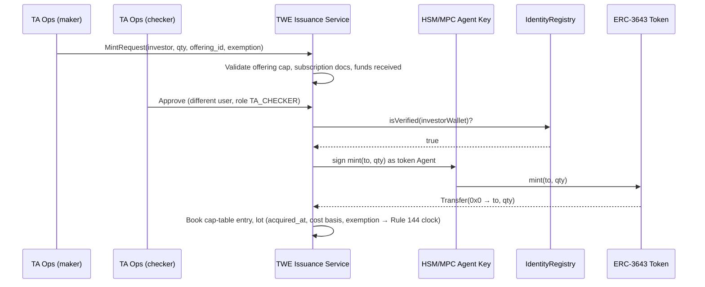

# 03 — Tokenization Protocols and Transfer-Agent Integration (Module D)

Status: Draft v1.0 · Owner: RWA Platform · Related: contracts/, doc 04 (settlement), doc 06 (cap table schema)

## 1. Principles

1. **One legal book of record per security.** For each instrument TWE records which party is the registered transfer agent (TA) and whether the on-chain token ledger *is* the master securityholder file or a mirror of it. Reconciliation (§10) is mandatory either way.
2. **Protocol adapters, not protocol forks.** TWE integrates each issuance platform through a `TokenizationAdapter`; TWE-issued instruments default to ERC-3643 (T-REX) with TWE's identity registry.
3. **Compliance is enforced twice**: off-chain by the compliance gate (pre-trade) and on-chain by the token's transfer-restriction logic (`canTransfer` / `detectTransferRestriction` / DS `preTransferCheck`). Off-chain approval never overrides an on-chain refusal.
4. Interfaces referenced here are in `contracts/`. DS Protocol interfaces there are an **approximation** for adapter design; the authoritative ABI is Securitize's.

## 2. Adapter contract

```ts
export interface TokenizationAdapter {
  platform: 'SECURITIZE_DS' | 'TREX' | 'DIGISHARES' | 'REPUBLIC' | 'VERTALO' | 'BITBOND' | 'BLOCKSQUARE';
  /** Register / update an investor identity at the platform; returns platform investor ref. */
  upsertInvestor(i: InvestorProfile): Promise<{ platformInvestorId: string; wallets: string[] }>;
  /** Pre-transfer check mirroring on-chain logic. Must not be treated as authoritative. */
  preTransferCheck(t: TransferIntent): Promise<{ ok: boolean; code: number; message: string }>;
  mint(req: MintRequest): Promise<TxRef>;        // issuance — requires dual-controlled approval id
  burn(req: BurnRequest): Promise<TxRef>;        // redemption / cancellation
  forceTransfer(req: ForceTransferRequest): Promise<TxRef>; // court order, lost-key recovery, error correction
  freeze(addr: string, amount?: bigint): Promise<TxRef>;
  unfreeze(addr: string, amount?: bigint): Promise<TxRef>;
  holders(atBlock?: bigint): Promise<Array<{ wallet: string; investorId: string; balance: bigint; frozen: bigint }>>;
  corporateAction(ca: CorporateActionSpec): Promise<{ caId: string; txs: TxRef[] }>;
}
```

## 3. Securitize DS Protocol

* **Architecture (public description)**: a DS Token (ERC-20 compatible) delegates checks to a set of services — Registry Service (investors, wallets, attributes such as KYC/accreditation/qualified status and country), Compliance Service (per-token rules: holder caps, jurisdiction rules, lock-ups, minimum holdings), Trust Service (roles: master, issuer, exchange, transfer agent), Lock Manager, and Comms. The exact ABI, versioning and role names must be confirmed from Securitize's documentation/repositories.
* **TWE role**: TWE typically acts as an *exchange/BD participant*, not issuer. TWE must obtain permission to register investors (or to request Securitize to do so) and to have its settlement wallets whitelisted.
* **Mint/burn**: issuer/TA-controlled; TWE never mints DS tokens. `IDSToken.issueTokens` in `contracts/IDSToken.sol` models the shape.
* **Identity sync**: TWE investor → `registerInvestor(id, collisionHash)` + `addWallet(wallet, id)` + attributes (`KYC_APPROVED`, `ACCREDITED`, country). Sync is event-driven from TWE onboarding; drift check nightly via registry reads.
* **Pre-trade**: call DS `preTransferCheck(from, to, value)` (approximate name) — returns code + reason; mapped into TWE reject code `ONCHAIN_RESTRICTION_<code>`.
* **Corporate actions**: dividends typically distributed by issuer/TA off-chain or via DS-integrated payout; TWE receives snapshot and record-date holder list for its customers' omnibus/individual wallets.

## 4. Tokeny T-REX / ERC-3643 + ONCHAINID (TWE default)

Components (ERC-3643):

| Component | Responsibility |
|---|---|
| `Token` (ERC-20 + ERC-3643) | Balances, `forcedTransfer`, `mint`, `burn`, partial/total freeze, pause, `recoveryAddress` |
| `IdentityRegistry` | wallet → ONCHAINID (`IIdentity`) + country; `isVerified(wallet)` |
| `IdentityRegistryStorage` | Shared storage, so many tokens can bind one registry |
| `TrustedIssuersRegistry` | Claim issuers and the topics each may issue |
| `ClaimTopicsRegistry` | Required claim topics for the token |
| `ModularCompliance` | `canTransfer(from,to,amount)` + hooks `transferred/created/destroyed`; plug-in modules (country restrictions, max holders, max balance, time-based lockups, supply limit) |
| ONCHAINID (`IIdentity` = ERC-734 + ERC-735) | Keys and signed claims per investor |

**Claim topics** used by TWE (doc 05 §8 gives full mapping): `1 KYC`, `2 AML/Sanctions screened`, `3 Accredited Investor (US)`, `4 Qualified Purchaser`, `5 Non-US Person (Reg S)`, `6 Qualified Institutional Buyer`, `7 Jurisdiction`, `10 Reg CF investment-limit attestation`.

`isVerified(wallet)` returns true iff the wallet has an identity and, for every required topic, there is at least one claim from a trusted issuer for that topic whose signature verifies and which is not revoked.

**Lifecycle**:



Burn (redemption): investor redemption request → cash leg confirmed → `burn(from, qty)` → cap table and tax lot closed. Forced transfer requires legal basis document attached and 4-eyes approval; recovery (lost wallet) uses `recoveryAddress(lost, new, investorOnchainID)`.

## 5. DigiShares

* White-label tokenization and investor-management platform focused on real estate funds/SPVs; supports issuance of security tokens and an investor portal / secondary trading module.
* **Integration**: REST API for investors, holdings and share registry — *to be confirmed against vendor docs*. Token standard used by a given deployment (ERC-20 with whitelist / ERC-1404-style restrictions) must be confirmed per issuer; TWE's adapter probes `detectTransferRestriction` via ERC-165 / call simulation and falls back to registry API checks.
* **Corporate actions**: rental income distributions are typically computed off-chain and paid in fiat or stablecoin; TWE ingests distribution files and reconciles.

## 6. Republic

* Republic operates a Reg CF funding portal and related Reg D / Reg A+ offering services, plus tokenization products (e.g., Republic Note) and, following the INX acquisition, secondary trading capacity (confirm current structure).
* **Relevance**: Reg CF securities carry a **one-year resale restriction** (Reg CF Rule 501, 17 CFR 227.501) with limited exceptions (issuer, accredited investor, registered offering, family member). The adapter must carry `issue_date` per lot and the compliance gate must block transfers before 12 months unless an exception claim is present.
* **Integration**: data feeds of investors/holdings per offering via API or file — *to be confirmed*.

## 7. Vertalo

* SEC-registered digital transfer agent and cap-table platform that connects issuers' records to multiple ATSs and blockchains.
* **Role for TWE**: candidate **registered TA of record** for TWE-onboarded issuers before TWE's own TA registration (doc 09). Vertalo's ledger is the master securityholder file; on-chain tokens mirror it.
* **Integration**: API for issuer, holders, transfers, and allocation events — *to be confirmed*. Settlement flow: TWE ATS trade → DvP → TWE submits transfer instruction to Vertalo → Vertalo updates master file and (if configured) moves token → TWE reconciles.

## 8. Bitbond

* German tokenization provider (Token Tool, white-label issuance; BaFin-regulated activities in Germany). Relevant to EU bonds including crypto-securities under Germany's eWpG (Electronic Securities Act), where a registrar (*Registerführer*) keeps the crypto securities register.
* **TWE relevance**: EU-issued tokenized bonds offered to US persons only under an applicable exemption (e.g., Reg S offshore transactions to non-US persons; 144A to QIBs). The compliance gate enforces Reg S distribution compliance periods by lot.
* **Coupons**: coupon schedule from term sheet; payments via stablecoin (EURC) or SEPA by paying agent; TWE reconciles holders at record date.

## 9. Blocksquare

* Real-estate tokenization protocol that issues property-backed tokens through licensed partners ("Oceanpoint" ecosystem / marketplace partners — confirm current naming). Legal wrapper and investor rights depend on the partner's jurisdiction.
* **TWE relevance**: treat Blocksquare tokens as securities in the US unless counsel concludes otherwise; onboard only via TWE-wrapped SPV or with a US-compliant issuer partner. Rent distributions follow §11.3.

## 10. Identity registry synchronization

Sources of truth:

* Off-chain: `investors`, `investor_credentials` (doc 06) — produced by KYC/KYB, sanctions, accreditation verification.
* On-chain: TWE `ITWEIdentityRegistry` + ONCHAINID claims (TWE-issued tokens); platform registries (DS, others).

Rules:

1. Off-chain change emits `InvestorEligibilityChanged` event (outbox). Sync worker computes the delta per bound registry and submits transactions with idempotency key `(investor_id, registry, version)`.
2. **Revocation is prioritized**: sanctions hits or KYC expiry produce on-chain `setAddressFrozen(wallet,true)` within 5 minutes and claim revocation; the compliance gate blocks immediately (it never waits for chain).
3. Nightly drift job: for each registry, enumerate registered wallets and compare to expected set; mismatches create `recon_breaks` with severity.
4. Wallet rotation: new wallet must pass key-control proof (signature challenge) before being added; old wallet balance moves via `recoveryAddress`/forced transfer under 4-eyes.

## 11. Corporate actions

Common flow: **announce → record date snapshot → entitlement calculation → funding → payment → reconciliation → tax reporting.**

### 11.1 Snapshot

`snapshot(instrument, record_ts)`: holders and balances at the last block with timestamp ≤ `record_ts` (per chain finality rules), joined with TA ledger. Frozen balances are entitled (freeze ≠ loss of ownership) unless the issuer's terms say otherwise; entitlement for frozen holders is held in escrow.

### 11.2 Dividends (equity)

```
entitlement_i = floor(balance_i * amount_per_share * 10^cash_decimals / 10^token_decimals)
residual      = total_funded − Σ entitlement_i    → returned to issuer or carried to next distribution
withholding_i = entitlement_i * rate(investor_i)   (W-9: backup withholding 24% if TIN missing/incorrect; W-8BEN(-E): treaty or 30% NRA)
net_i         = entitlement_i − withholding_i
```

Payment via `ITWECorporateActions` (push for ≤ 500 holders, Merkle-claim for larger sets) or fiat batch. 1099-DIV / 1042-S generated from `ca_payments`.

### 11.3 Rent distributions (real estate SPVs)

`distributable = gross_rent − opex − reserves − mgmt_fee`; per-token as dividends. Distributions may be partly return of capital; tax character is set by the issuer's accountant and drives 1099-DIV boxes or K-1 (partnership SPVs).

### 11.4 Coupons (debt)

```
accrual (30/360):   C = face * rate * ((360*(Y2−Y1) + 30*(M2−M1) + (D2−D1)) / 360)
accrual (ACT/365F): C = face * rate * days / 365
```

Ex-coupon period per terms; principal at maturity via `burn` + cash payment in one DvP-like batch (§doc 04 redemption flow).

### 11.5 Other actions

Splits/reverse splits (mint/burn pro-rata with fractional cash-in-lieu), tender offers (escrow lock + conditional burn), mergers (token swap), name/symbol changes (metadata only; CAT/ORF symbol updates where applicable).

## 12. Transfer-agent book-of-record reconciliation

Three-way recon, run on every settlement batch and nightly in full:

| Source | Key | Values |
|---|---|---|
| A. TA master securityholder file (TA platform or TWE TA ledger) | (instrument, holder) | units, restricted legend flags, lot dates |
| B. On-chain balances (at finalized block) | (token, wallet → holder via registry) | balance, frozen |
| C. TWE BD customer ledger (omnibus subaccounts, 15c3-3 possession/control) | (account, instrument) | positions, pending settlement |

Breaks: `A≠B` (TA/on-chain divergence), `B≠C` (BD books vs wallet), unexpected wallet holders, supply mismatch (`totalSupply ≠ Σ A`). SLA: zero unexplained breaks at end of day; any break in a customer-owned position over 1 business day escalates to CCO and FinOp (15c3-3 possession/control). TA recordkeeping requirements (Rule 17Ad-10 accurate securityholder files, 17Ad-7 retention) apply to the registered TA; TWE builds its ledger to that standard regardless.

Turnaround: Rule 17Ad-2 turnaround standards apply to registered TAs for routine items; TWE's TA ledger targets same-day posting of settled trades.
