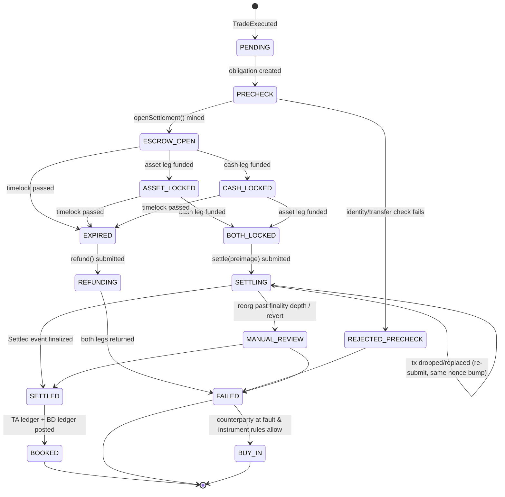

# 04 — Settlement, Clearing, Custody and Margin

Status: Draft v1.0 · Owner: Post-Trade · Related: contracts/ITWEDvPEscrow.sol, doc 06 (`settlements`, `settlement_legs`), Rule 15c3-3, Rule 15c3-1

## 1. Settlement models

| Model | Where used | Finality | Principal risk | Notes |
|---|---|---|---|---|
| **On-chain atomic DvP (escrow)** | Module A TWE-issued ERC-3643 tokens vs USDC/EURC/USDS on same chain | Chain finality (e.g., Ethereum ~2 epochs ≈ 13 min for economic finality; L2s depend on settlement to L1) | ~0 once both legs escrowed | Default for Module A |
| **On-chain agent-mediated** | Tokens whose TA/issuer must execute transfer (DS, some partners) | TA execution | Short window between cash and token moves | Cash pre-funded in escrow; released on TA confirmation |
| **Off-chain T+0 batch** | Fiat cash leg, intraday net | Fedwire finality | Netting exposure intraday | Batches 11:00, 14:00, 16:30 ET |
| **Off-chain T+1 batch** | Fiat ACH-funded accounts; venues using T+1 | ACH/Fedwire | 1-day exposure | Aligns with US T+1 standard for broker-dealer transactions (Rule 15c6-1 as amended, effective May 28, 2024) where applicable |
| **Module C crypto spot** | Internal ledger, periodic on-chain withdrawals | Internal ledger final at match | Covered by pre-funding/margin | No securities |

Rule 15c6-1 applies to securities transactions by BDs, with exemptions (e.g., certain limited partnership interests not listed on an exchange, and securities for which no transfer is possible within T+1 by agreement at time of trade). Counsel to confirm applicability per instrument; the default config is T+1 or faster.

## 2. DvP orchestrator state machine



Implementation rules:

* Each transition is a row in `settlement_events` (append-only) with `(settlement_id, from_state, to_state, cause, tx_hash, block_number, log_index)`.
* Steps are **idempotent**: every on-chain call is keyed by `settlementId = keccak256(trade_id, venue_id, chain_id)`; the contract rejects duplicate `openSettlement`.
* **Outbox pattern**: state change + outbound command written in one Postgres transaction; a relay submits commands; chain observers (≥ 2 independent RPC providers + own node) confirm events after `finality_depth[chain]`.
* **Sandbox prototype**: implements the same states with simulated legs; transitions are driven by a timer instead of chain events.

## 3. On-chain atomic swap via escrow

Escrow (`ITWEDvPEscrow`) holds both legs, keyed by `settlementId`, with:

* `hashlock = keccak256(preimage)` — preimage generated by the orchestrator and revealed only in `settle`. Prevents a third party from triggering settlement and enables cross-chain HTLC variants (asset on chain X, cash on chain Y) where each chain has its own escrow with the same hashlock; the preimage revealed on one chain unlocks the other.
* `timelock` — absolute timestamp; after it, anyone may call `refund` and each leg returns to its depositor. Default: 30 minutes for same-chain, 6 hours for cross-chain (cash-side timelock MUST be shorter than asset-side by ≥ 1 hour for the party who reveals last; standard HTLC ordering).
* ERC-3643 compatibility: escrow contract wallet must be registered in the identity registry (as TWE-controlled "settlement agent" identity) or the compliance module must exempt it; buyer's `isVerified` is re-checked in `settle` (via `canTransfer`) so a buyer frozen mid-settlement causes revert → refund path.
* Fees: deducted from cash leg to `feeRecipient` in the same `settle` call.

Same-chain variant (no hashlock needed) is supported with `hashlock = 0` and `settle` restricted to `SETTLER_ROLE`.

## 4. Off-chain batch clearing (T+0 / T+1)

```
for each batch window W:
  trades = SELECT ... WHERE settle_date <= today AND model IN ('OFFCHAIN_T0','OFFCHAIN_T1') AND state='PENDING'
  net_cash[participant]   = Σ (sell_notional − buy_notional − fees)
  net_units[participant][instrument] = Σ (buy_qty − sell_qty)
  -- securities are NOT netted across instruments; cash netted per currency
  verify: Σ net_cash = −fees_total; Σ net_units[*][i] = 0 for each instrument i
  pay-ins: participants with net_cash < 0 must fund by cutoff (Fedwire) or are failed
  deliveries: TA/token transfers for net_units after all pay-ins confirmed (DvP model 3 — net/net)
```

If a participant fails to fund: remove its trades, recompute net (unwind), mark removed trades `FAILED`, apply fail charges and close-out per rulebook. Because net/net exposes others to recomputation, high-risk participants are put on **gross (DvP model 1)** settlement.

## 5. Fiat rails and custody

* **Fedwire Funds**: final, gross; used for large/batch pay-ins. Account at a settlement bank (TWE does not hold a Fed master account). Reference format: IMAD/OMAD captured into `cash_movements`.
* **ACH**: for retail-scale funding; not final (returns up to 2 banking days for most return codes, 60 days for unauthorized consumer debits). Funds from ACH debits are **not** usable for settlement until the return window risk is accepted by credit policy (default: hold 4 business days or require pre-funded balance).
* **Prime Trust caveat**: Prime Trust, LLC, a Nevada trust company widely used in digital-asset fiat on/off-ramping, entered receivership and filed for Chapter 11 bankruptcy in 2023. TWE MUST NOT depend on a single non-bank trust company for customer cash. Recommended: (1) a federally insured bank for the special reserve / FBO accounts; (2) **North Capital** (escrow/payments infrastructure used in private-securities offerings) and/or (3) a qualified custodian (bank or chartered trust company subject to examination) for securities and digital-asset custody, with contractual segregation, bankruptcy-remote structure, and daily reconciliation. Counterparty due diligence is annual plus on-trigger.
* **Stablecoins**:
  * **USDC** (Circle) and **EURC** (Circle, euro) — fiat-backed; redemption via Circle Mint account; MiCA-relevant for EU flows.
  * **USDS** (Sky Protocol, formerly Maker; successor to DAI) — crypto-collateralized; treat as higher risk (haircut in margin, not accepted for Module A cash leg without CCO approval).
  * Regulatory: the US GENIUS Act (2025) establishes a framework for payment stablecoins; implementing rules and issuer licensing status MUST be checked per coin before accepting it as a settlement asset. Accepted-asset list lives in `settlement_assets` with `approved_by`, `approved_at`, `haircut_bps`.
  * Depeg circuit breaker: if a stablecoin's reference price deviates > 50 bps from par for 15 min, new settlements in that asset pause; open escrows continue to their timelock.

## 6. Failure and rollback handling

| Failure | Detection | Handling |
|---|---|---|
| Seller tokens not deposited | Timelock expiry with ASSET leg missing | Refund cash; seller fail record; surveillance flag (repeat fails → fair-access review) |
| Buyer cash not deposited | Timelock expiry, CASH missing | Refund tokens; buyer fail; credit limit reduced |
| On-chain revert in `settle` (compliance change) | Tx receipt status 0 | Re-run precheck; if eligible again within timelock, retry once; else refund |
| Reorg removing `Settled` | Observer sees block hash change below finality depth | State → `MANUAL_REVIEW`; re-submit; no TA booking until final |
| Gas spike | Fee estimator > cap | Use EIP-1559 bump up to cap; beyond cap page ops (no silent delay past timelock) |
| TA rejects transfer (agent-mediated) | TA response | Cash returned from escrow; trade broken with both parties notified; CAT/ORF corrections as needed |
| Key compromise | HSM/MPC alert | Pause escrow (`pause()` by GUARDIAN), rotate keys, 4-eyes resume |

Trade breaks (clearly erroneous) follow the published TWE ATS rulebook, are journaled as `TRADE_BREAK` admin commands, and are reflected in CAT (trade correction) and ORF if applicable.

## 7. Rule 15c3-3 (customer protection) considerations

* **Possession or control**: fully paid and excess margin customer securities must be in TWE BD's possession or control. For tokenized securities this means: tokens held in wallets controlled by TWE BD (HSM/MPC, with documented key-control procedures) or at a good control location (e.g., registered TA book-entry in TWE's name for the benefit of customers, or a qualified bank custodian). Customer-controlled self-custody wallets are **not** TWE possession/control — such accounts are designated "self-custody" and TWE does not carry them.
* **Reserve formula**: customer credits (cash awaiting settlement, free credit balances) minus debits; deposit to the Special Reserve Bank Account for the Exclusive Benefit of Customers. Computation weekly, or **daily** for carrying BDs whose average total credits meet the threshold in the 2024 amendments (US$250 million; confirm threshold and compliance date with FinOp).
* **Stablecoins in customer accounts**: whether a stablecoin balance is a "free credit balance", a security, or other property affects treatment; obtain counsel/FinOp position before offering stablecoin cash legs to BD customers. Pending legs in DvP escrow are customer property in transit and are tracked as such.
* **Digital-asset securities custody**: the SEC's 2020 statement on special-purpose broker-dealer custody of digital asset securities, and later staff statements/FAQs (2025), shape how a BD may claim possession or control of crypto-asset securities — confirm current posture before go-live.
* **Net capital (15c3-1)**: haircuts on proprietary token positions; unsecured receivables from failed settlements are non-allowable after the applicable aging period.
* Module C (crypto, non-security) assets are held by a separate entity and never commingled with BD customer property.

## 8. Margin engine (Module C — crypto spot and derivatives)

Applies to non-security crypto assets on the Module C venue. (Margin on securities is out of scope v1; Reg T / FINRA 4210 would apply.)

### 8.1 Definitions

For account `a`, positions `p` with size `q_p` (signed), mark price `M_p`, entry price `E_p`, contract multiplier `m_p`:

```
Notional_p        = |q_p| · M_p · m_p
UPnL_p            = q_p · (M_p − E_p) · m_p                      (linear perps/futures)
IM_p              = Notional_p · imr(tier(Notional_p))            initial margin rate, tiered by notional
MM_p              = Notional_p · mmr(tier(Notional_p))            maintenance, mmr = imr / 2 typical
Collateral value  = Σ_c balance_c · price_c · (1 − haircut_c)     USDC 0%, EURC 1% + FX, BTC 5%, ETH 8%, USDS 3%
```

Mark price = median(index price from ≥ 3 external spot venues, fair basis price, last trade) — prevents manipulation of liquidation by single-venue spikes.

### 8.2 Cross margin

```
Equity_a      = CollateralValue_a + Σ_p UPnL_p
IM_a          = Σ_p IM_p      (+ open-order margin: Σ_o worst-case IM if filled)
MM_a          = Σ_p MM_p
Available_a   = Equity_a − IM_a                    new orders allowed iff Available_a ≥ 0 after order
MarginRatio_a = MM_a / Equity_a                    liquidation when MarginRatio_a ≥ 1
```

### 8.3 Isolated margin

Per position `p` with allocated margin `A_p`:

```
Equity_p = A_p + UPnL_p ;  liquidate p when Equity_p ≤ MM_p
Liquidation price (long, linear):  L = (E·|q|·m − A_p) / (|q|·m·(1 − mmr))
Liquidation price (short, linear): L = (E·|q|·m + A_p) / (|q|·m·(1 + mmr))
```

Losses on an isolated position never draw on other account collateral beyond `A_p`.

### 8.4 Spot margin (borrow)

`LTV = borrowed_value / collateral_value`; margin call at 80%, liquidation at 90%, max initial LTV 66%. Interest accrues hourly.

### 8.5 Liquidation waterfall

1. **Pre-liquidation**: at MarginRatio ≥ 0.8, notify; at ≥ 0.9 cancel the account's open orders that increase risk.
2. **Partial liquidation**: reduce positions to bring MarginRatio to 0.7, largest-risk first, via IOC orders into the book at bankruptcy-price-bounded limits (max 20% of position per 10 s slice).
3. **Full liquidation**: if partial fails or MarginRatio ≥ 1.0, liquidation engine takes over the position at bankruptcy price.
4. **Insurance fund**: absorbs the difference between bankruptcy price and the liquidation fill; liquidation fees (e.g., 0.5% of notional) accrue to the fund when fills are better than bankruptcy price.
5. **Auto-deleveraging (ADL)**: if insurance fund is insufficient, opposite-side positions are reduced, ranked by `profit_ratio × effective_leverage`, at the bankruptcy price. ADL ranking is published in real time (quintile indicator).
6. **Socialized loss** is not used; ADL is the terminal step.

All liquidation actions are sequenced commands in the core WAL (`kind=LIQUIDATE`) — fully replayable.

### 8.6 Permissioned pairs via soulbound credentials

Certain Module C pairs (e.g., derivatives available only to eligible contract participants, or pairs restricted by jurisdiction) require a non-transferable credential:

* Credential: ERC-5192-style token (`ITWESoulboundCredential`) minted to the account's verified wallet with `credentialType` (e.g., `ECP`, `NON_US_PERSON`, `PROFESSIONAL_CLIENT`), `expiry`, `issuer`, and evidence hash (VC 2.0 credential ID, doc 05 §8).
* Pre-trade check: `hasValidCredential(wallet, type)` read from cache refreshed by `CredentialIssued/Revoked` events; order rejected with `5012=CREDENTIAL_REQUIRED` otherwise.
* Revocation is immediate off-chain (gate) and on-chain within 5 minutes. Positions in a pair whose credential lapses are reduce-only.
