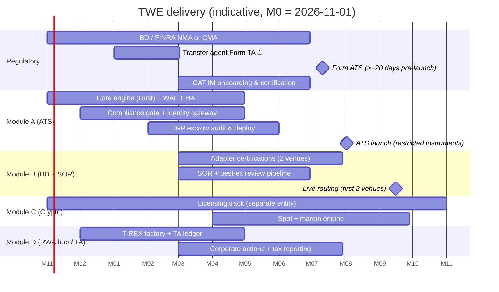

# 09 — Delivery Roadmap

Status: Draft v1.0 · Owner: PMO with CCO and CTO · Dates are relative to program start (M0). Regulatory durations are estimates; regulators control their own timelines.

## 1. Phase overview

## 2. Module A — ATS for tokenized private securities

| Milestone | Exit criteria |
|---|---|
| A0 Sandbox (done) | Sandbox prototype: TS matching with advisory locks + WAL table, compliance gate, FIX 35=D/35=8 encoder, surveillance rules, DvP state machine, admin console |
| A1 Core parity | Rust core passes all golden-journal vectors produced by the sandbox TS engine (differential test, identical digests) |
| A2 Hardening | HA failover drill RTO ≤ 5 s, RPO 0; load 5× peak; p99 order-to-ack ≤ 200 µs; chaos tests on journaler/replicator |
| A3 Compliance complete | All gate rules (doc 05 §1.2) with test matrix sign-off by CCO; books-and-records mapping to 17a-3/17a-4 and Rules 302/303; 301(b)(10) safeguards documented and RLS tested |
| A4 Smart contracts | `TWEDvPEscrow` + ERC-3643 suite: two independent audits, formal verification of escrow invariants (no leg released without both funded; refund only after timelock), bug bounty |
| A5 Launch | Form ATS effective (filed ≥ 20 calendar days prior), ATS rulebook and subscriber agreements, ATS-N-equivalent public disclosure, FINRA MPID, first restricted instruments live with 3–5 subscribers |

## 3. Module B — BD portal and SOR

| Milestone | Exit criteria |
|---|---|
| B1 Adapter framework | `VenueAdapter` contract (doc 02 §2) frozen; simulated adapters for 7 venues with conformance suite |
| B2 First live venues | Commercial agreements + subscriber onboarding + certification for 2 venues (selection by instrument overlap) |
| B3 Best-ex program | Best Execution Committee chartered; quarterly regular-and-rigorous review report generated from production data; WSPs updated (Rule 3110) |
| B4 Routing disclosure | Quarterly 606-style public disclosure |
| B5 Remaining venues | Incremental, each gated by §5 checklist |

## 4. Module C — Crypto spot and derivatives

Separate legal entity and licensing track. Prerequisites: FinCEN MSB registration; state money transmitter licenses / NYDFS BitLicense as applicable; derivatives only via an appropriately registered entity (e.g., DCM/FCM/SEF relationships with the CFTC) or offered only to non-US persons from an appropriately licensed non-US entity; per-asset legal analysis that the asset is not a security. Milestones: C1 spot with pre-funded accounts → C2 isolated margin → C3 cross margin + liquidation engine + insurance fund → C4 derivatives (perps/futures) with permissioned pairs via soulbound credentials.

## 5. Module D — RWA liquidity hub and transfer agency

| Milestone | Exit criteria |
|---|---|
| D1 Contracted TA | Agreement with a registered digital TA (e.g., Vertalo or issuer's TA) for first issuers; three-way recon live |
| D2 TWE TA registration | Form TA-1 filed with SEC (registration becomes effective 30 days after filing unless accelerated or the SEC acts otherwise); TA rules program (17Ad-2 turnaround, 17Ad-10 recordkeeping, 17Ad-17 lost securityholder searches) |
| D3 Protocol adapters | T-REX (native), DS Protocol (read + exchange role), then DigiShares/Republic/Bitbond/Blocksquare by pipeline demand |
| D4 Corporate actions + tax | Dividends/coupons/rent with withholding; 1099-B/DIV/INT, 1042-S, K-1 delivery; IRS e-file test |

## 6. Regulatory prerequisites (critical path)

| # | Item | Owner | Notes |
|---|---|---|---|
| R1 | **Broker-dealer registration** — Form BD via CRD (SEC + states), SIPC membership | CCO | Required to operate an ATS and route customer orders |
| R2 | **FINRA membership** — New Member Application (Rule 1013) if new BD; **Continuing Membership Application** (Rule 1017) if an existing BD adds ATS / digital-asset-securities business (material change). Statutory 180-day target for NMA decisions; plan for longer for digital-asset business | CCO / counsel | Business plan, WSPs, net capital computation, 15c3-3 posture (carrying vs non-carrying), custody arrangements |
| R3 | **Form ATS** — filed at least **20 calendar days before operation** (Rule 301(b)(2)(i)); amendments 20 days before material changes; Form ATS-R quarterly | CCO | Form ATS-N not required (no NMS stocks); publish equivalent disclosures |
| R4 | **Transfer agent registration** — Form TA-1 (if TWE acts as TA) | TA lead | Otherwise contract a registered TA |
| R5 | **CAT** — IM registration, CAT Reporter IDs, CAIS onboarding, industry test environment certification | Reg reporting | Only for CAT-eligible instruments (doc 05 §1.1); OATS no longer exists |
| R6 | **FINRA reporting** — ORF / TRACE participation, MPID, Rule 4552 ATS reporting setup | Reg reporting | As applicable per instrument profile |
| R7 | **Form 211 / 15c2-11 program** | Compliance | If TWE ATS functions as a quotation medium for OTC Equity Securities |
| R8 | AML program (BSA), CIP, OFAC, FinCEN registration where required; SAR procedures | AML officer | Both entities |
| R9 | Custody/qualified custodian agreements; settlement bank; stablecoin issuer accounts (Circle Mint) | Treasury | Avoid single non-bank trust dependency (Prime Trust lesson, doc 04 §5) |
| R10 | State blue-sky analysis for secondary trading of each instrument | Counsel | Especially Reg A Tier 1/2 secondary trades |
| R11 | Reg S-P / cybersecurity program (including 2024 Reg S-P amendments: incident response, customer notification) | CISO | |

## 7. Turning simulated adapters into live adapters

The sandbox prototype flips an adapter to `live` when its credential env vars are present (doc 02 §3). Production requires **all** of the following, tracked in `venue_enablement` (doc 06), before `mode='live'` is accepted:

1. **Commercial & legal**: executed subscriber/market-access agreement; fee schedule loaded; data redistribution terms recorded.
2. **Regulatory**: Compliance review of venue's Form ATS disclosures, rulebook, settlement model, and custody; WSP update; venue added to best-ex review universe; routing disclosure updated.
3. **Onboarding**: TWE (and, where required, each end investor) onboarded at the venue; account mapping (`investorRef.venueAccountId`) populated; identity sync to venue registry (e.g., DS registry) verified.
4. **Technical certification**: vendor certification scripts passed in vendor UAT (order types, cancels, rejects, fills, reconnect, sequence gaps); API contract confirmed against **vendor certification docs** — replace every *"to be confirmed"* item in doc 02 with confirmed specs; contract tests recorded as fixtures.
5. **Security**: credentials stored in secret manager (not plain env in production — env injection from vault at runtime), mTLS certs with rotation, egress allowlist to venue endpoints, least-privilege API scopes.
6. **Reconciliation**: end-of-day order/fill/position recon with venue drop copy or reports; settlement recon with venue/TA; zero breaks for 10 consecutive UAT days.
7. **CAT linkage**: MEOR → venue MEOA linkage validated in CAT test environment (for CAT-eligible instruments).
8. **Kill switch**: per-venue disable tested; open-order reconciliation on disable.
9. **Pilot**: limited customers and notional caps for 30 days; daily review; then Compliance sign-off sets `compliance_signoff_at`, the DB check constraint allows `mode='live'`.

## 8. Key risks

| Risk | Mitigation |
|---|---|
| Regulatory timeline slip (FINRA CMA/NMA) | Run sandbox pilots with no customer assets; parallelize engineering |
| Venue API instability / non-public specs | Adapter contract isolates; simulated mode for development; certification gate |
| Smart-contract vulnerability | Audits, formal verification, pause guardian, limited TVL caps at launch |
| Custody partner failure | Multi-custodian design, daily recon, bankruptcy-remote structures |
| Thin liquidity in tokenized securities | Module B routing to external venues; periodic call auctions (v2) for illiquid instruments |
